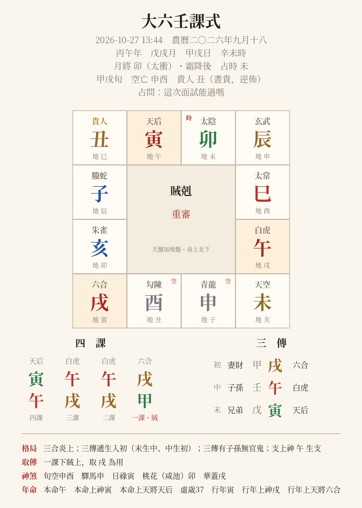

# 大六壬 Claude Skill（da-liu-ren）

讓 Claude 會**起大六壬課、排盤、判課體、依占問解卦**的 Agent Skill。

- 依公曆時間自動算日干支、占時、**月將**（以中氣交接時刻為準）
- 月將加時 → **天地盤** → **四課** → **九宗門取三傳**（賊剋、比用、涉害／見機／察微／綴瑕、遙剋、昴星、別責、八專、伏吟、返吟）
- **十二天將**（晝夜貴人、順逆佈）、**遁干**、**六親**、**旬空**、**月令旺衰**、驛馬／日祿／桃花／華蓋、**本命行年**
- 自動辨識三傳格局（三合、進退茹、間傳、遞生遞剋、傳財化鬼…）
- 輸出文字、JSON、**排盤圖 PNG**
- 附解卦流程與速查表（課體、天將、各類占事類神），由 Claude 綜合解讀



## 安裝

**Claude.ai／Claude 桌面版**：把 `da-liu-ren/` 資料夾壓成 zip，在「設定 → Capabilities → Skills」上傳。

**Claude Code**：
```bash
git clone https://github.com/<你的帳號>/da-liu-ren-skill.git
cp -r da-liu-ren-skill/da-liu-ren ~/.claude/skills/
pip install -r da-liu-ren-skill/requirements.txt
```

安裝後直接問 Claude，例如：「幫我起一課六壬，這次面試能過嗎？」「用大六壬看 2026-11-03 15:20 丟的錢包找不找得回來」。

## 單獨使用排盤腳本

```bash
pip install -r requirements.txt
cd da-liu-ren/scripts

python3 liuren.py                                   # 以現在時間（台北）起課
python3 liuren.py --date "2026-10-27 13:44" -q 面試  # 指定時間
python3 liuren.py --day 甲子 --hour 午 --general 亥   # 直接給日干支／占時／月將
python3 liuren.py --date "2026-10-27 13:44" --birth-year 1990 --gender 男 --png out.png
python3 liuren.py --date "2026-10-27 13:44" --json
```

| 選項 | 說明 |
|---|---|
| `--hour` | 覆寫占時（報時、報數起課） |
| `--general` | 覆寫月將 |
| `--guiren daquan` | 改用《六壬大全》「甲羊戊庚牛」貴人歌訣（預設通行「甲戊庚牛羊」） |
| `--daynight 晝/夜` | 強制晝貴或夜貴（預設卯至申為晝） |
| `--no-zi-rollover` | 23 點後不換日（預設子初換日） |
| `--shehai shouke` | 涉害一律數受剋（預設：賊數剋上神、剋數上神所剋） |
| `--tz` | 未給時間時的時區（預設 +8） |

## 正確性

- 四課、天地盤、十二天將：與 [kinliuren](https://pypi.org/project/kinliuren/) 及 [wlhyl/dalurenpython](https://github.com/wlhyl/dalurenpython) 比對，全部一致（720 課 × 晝夜）。
- 三傳：與 wlhyl/dalurenpython 逐課比對，**720 / 720 課一致**。回歸測試見 `tests/`：

```bash
python3 tests/test_engine.py
```

各派在涉害計法、貴人歌訣、子時換日上做法不同，均提供選項。

## 結構

```
da-liu-ren/               ← Skill 本體（安裝這個資料夾）
├── SKILL.md              ← 起課與解卦流程
├── scripts/
│   ├── liuren.py         ← 排盤引擎 + CLI
│   └── chart.py          ← 排盤圖
└── references/
    ├── interpretation.md ← 解卦步驟
    ├── keti.md           ← 九宗門與課體、格局
    ├── tianjiang.md      ← 十二天將與神煞
    └── leishen.md        ← 各類占事類神
tests/                    ← 720 課回歸測試
examples/                 ← 範例輸出
```

## 聲明

大六壬為傳統術數，本專案供學習與參考；健康、法律、財務等重大決定請諮詢專業人士。

MIT License
